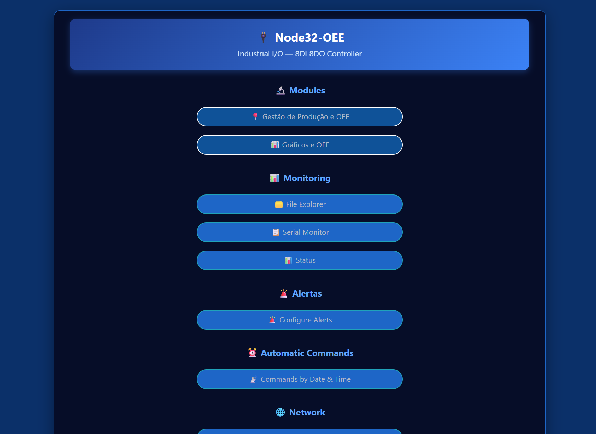
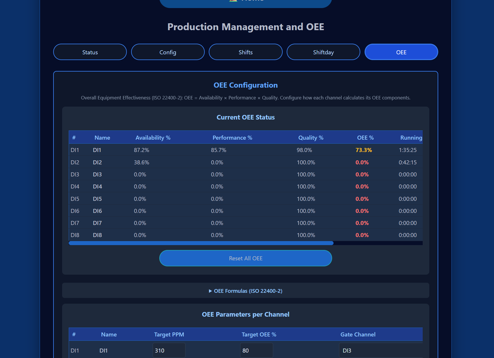
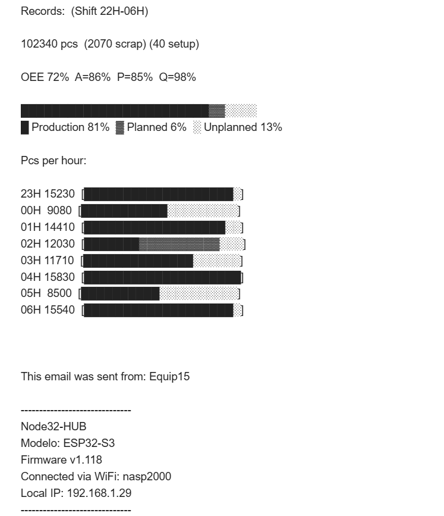
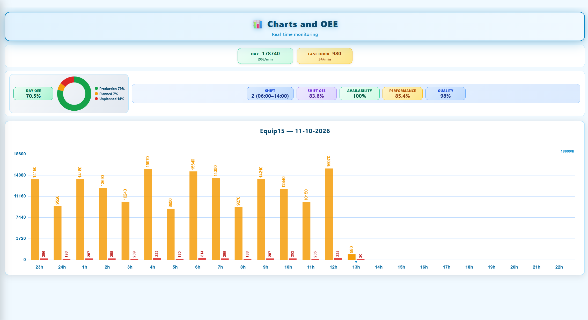

# Node32-OEE

**Industrial OEE and production-counting firmware for ESP32-S3 (N16R8) hardware** — part of the [Node32-HUB](https://github.com/nasp2000/Node32-HUB) project.

> Current release targets the **Waveshare ESP32-S3-POE-ETH-8DI-8DO** industrial controller (ESP32-S3, 16&nbsp;MB flash + 8&nbsp;MB PSRAM).

Node32-OEE follows the main [Node32-HUB](https://github.com/nasp2000/Node32-HUB) project, whose core feature is being **automatic**: counting, shift reports, OEE math and email alerts all run on their own — no manual steps on the factory floor.

> **For line managers:** with this OEE automation, every count plus early alerts on stoppages or low OEE go straight from the equipment to your email inbox.

🎬 **Demo video:** [Node32-OEE_video.mp4](image/Node32-OEE_video.mp4)

<table>
  <tr>
    <td width="50%"></td>
    <td width="50%"></td>
  </tr>
  <tr>
    <td width="50%"></td>
    <td width="50%"></td>
  </tr>
</table>

📷 [More screenshots](image/)

---

## Features

### Production counting (`/proximity`)
- **8 independent channels** (DI1…DI8), each PNP/NPN
- **COUNTER** mode — pulse counting (Count IN / Count OUT), with optional relay pulse output
- **PRESENCE** mode — live ON/OFF detection only
- **SPEED** mode — pulses-per-minute and cycle time between pulses
- **Shift management** — automatic shift transitions, CSV reports to SD, SHIFTDAY email command
- **OEE** — Availability × Performance × Quality per channel, with per-channel targets

### Live dashboard (`/proximity-dashboard`)
- Read-only, TV-style wallboard: one 24-hour per-hour chart per channel in use, rendered locally on canvas
- Real-time **OEE / A / Q / P** row with the current-shift indicator
- Light theme, designed for a big screen in the factory, auto-refresh every 2 s

### Alerts (`/alerts-config`)
- **Inactivity alerts** — up to 6 slots email when a channel stops receiving data for 5 min → 24 h
- **OEE alerts** — up to 3 slots email when Shift/Day OEE or Availability stays below target (with a per-day cap)

### Network & storage
- **Ethernet (W5500)** + Wi-Fi AP/station with HTTP Basic Authentication
- **SD card storage** — shift CSV reports and logs under `/`
- **File manager** and SD card pages + **FTP client** uploads
- **Monitor page** — live web serial/status monitor
- NTP time sync, OTA updates, scheduled daily reboot

---

## Hardware Recommendation

[**Waveshare ESP32-S3-POE-ETH-8DI-8DO**](https://www.waveshare.com/esp32-s3-poe-eth-8di-8do.htm) — industrial ESP32-S3 controller (N16R8 module: 16&nbsp;MB flash, 8&nbsp;MB PSRAM) with 8 opto-isolated digital inputs, 8 relay outputs, W5500 Ethernet and PoE power.

The only tested board. The digital inputs map directly to the proximity/encoder channels (DI1…DI8). Any ESP32-S3 N16R8-based hardware with equivalent isolated inputs and Ethernet can be evaluated on request.

---

## Quick start

1. Flash the pre-built binary to your ESP32-S3 8DI8DO (binaries in Releases) using [webflasher_Node32-HUB](https://github.com/nasp2000/webflasher_Node32-HUB). For future updates use **OTA** at `http://<esp32-ip>/ota`
2. Connect the board over **Ethernet (PoE)** and wire your sensors to DI1…DI8
3. Open `http://node32-oee.local/proximity` in a browser (mDNS — follows the System Name) or `http://<esp32-ip>/proximity`, and log in (default `root`/`root`)
4. Configure each active channel (mode, sensor type, shift times) and watch counts / OEE on the dashboard

> For pre-built binary downloads and enterprise deployments, please contact the project author: [nasp2000](https://github.com/nasp2000).

---

## First Access

1. Flash the pre-built binary
2. Wait for AP **NODE32-HUB**
3. Connect with password **12345678**
4. Browse to `http://192.168.4.1`
5. Login with user **root** / password **root**
6. Go to **Settings → Wi-Fi** and connect to your local network (or use Ethernet)
7. Once connected, the AP turns off automatically and the device is reachable at `http://node32-oee.local` (mDNS — follows the System Name) or the assigned IP

> If the device loses connection to the network, it reactivates AP mode automatically.

---

## License

Released under the MIT License — see [LICENSE](https://github.com/nasp2000/Node32-HUB/blob/main/LICENSE) in the main repository. This firmware links LGPL-2.1/LGPL-3.0 libraries; see [THIRD_PARTY_NOTICES](https://github.com/nasp2000/Node32-HUB/blob/main/THIRD_PARTY_NOTICES).
